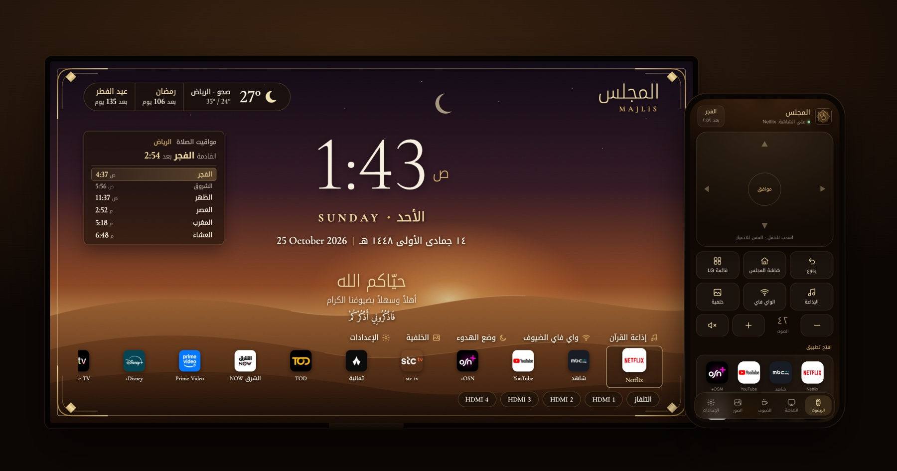
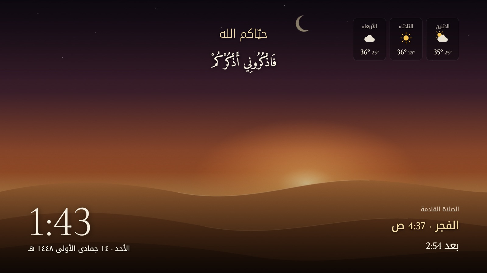
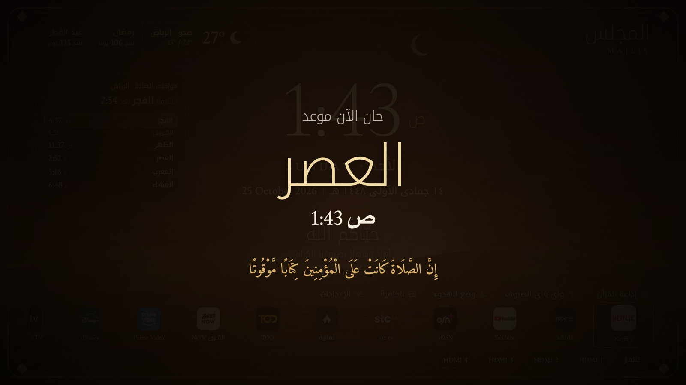
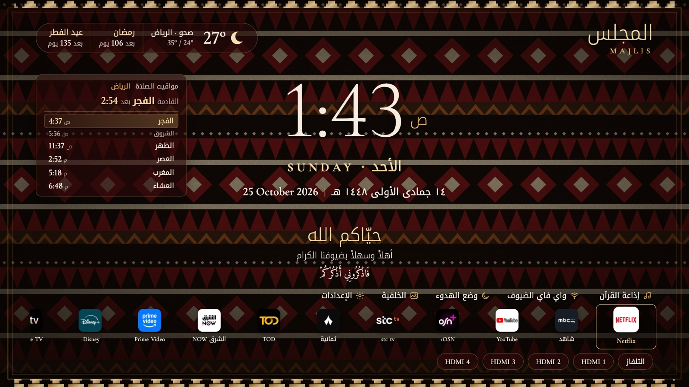
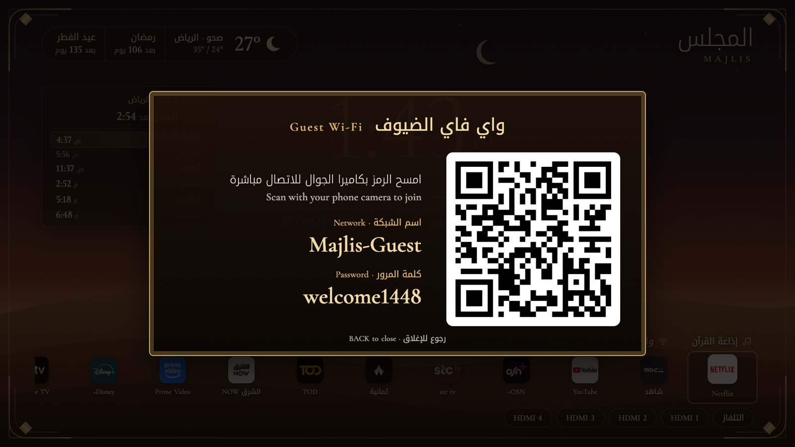

<p align="center">
  
</p>

<h1 align="center">Majlis · مجلس</h1>

<p align="center">
  A new interface for your TV, shaped around what you need.<br>
  Prayer times, Quran radio, Hijri dates and a phone remote.
</p>

<p align="center">
  <a href="README.ar.md">العربية</a> ·
  <a href="docs/en/install.md">Install</a> ·
  <a href="docs/en/ai-help.md">AI help</a> ·
  <a href="docs/en/features.md">Features</a> ·
  <a href="docs/en/phone.md">Phone app</a> ·
  <a href="docs/en/how-it-works.md">How it works</a> ·
  <a href="docs/en/troubleshooting.md">Troubleshooting</a>
</p>

<p align="center"></p>

---

Smart TVs ship with interfaces built for selling content. Majlis gives your TV a new one that you shape around what you actually need: the clock and the date in both calendars, the next prayer and how long until it, the weather, a welcome for guests, and your apps underneath, without ads or recommendations. Keep what you use, hide what you don't.

It runs on the TV itself. Once it's installed you don't need a computer, a cloud account or a subscription. Your phone becomes the remote and the control panel.

## What it does

**Prayer and Quran**
- Prayer times for 23 cities in the Gulf (Umm al-Qura for Saudi Arabia, with the Ramadan Isha rule), calculated on the TV every day
- At adhan time: a full-screen card on the home screen, and a notification over Netflix, YouTube or any other app
- Optional: pause the video or lower the volume during the adhan, then put it back
- Optional adhan sound, a reminder before the adhan, and a Friday mode (Jumu'ah, a Surat Al-Kahf reminder, morning Quran radio)
- Quran radio with 14 stations, including Saudi Quran Radio live

**The majlis**
- Hijri and Gregorian dates, and countdowns to Ramadan, Eid and Arafah
- A welcome line for guests, and scheduled occasions ("family dinner, 9 pm") with a countdown and a welcome card when the time comes
- Messages from your phone shown as a full-screen card ("the coffee is ready")
- A guest Wi-Fi card: guests scan a QR code and join without asking for the password

**The screen**
- Three themes, six accent colours, six frames and seven backgrounds, including Najdi Sadu and desert dusk, plus your own photos
- Calm mode: a slow photo slideshow with the time, a verse, the 3-day forecast and the next prayer, instead of LG's screensaver
- The Home button opens Majlis instead of LG's launcher
- New apps you install appear automatically; reorder or hide any of them
- An optional energy-saving timer turns the TV off when no one is using it, after a one-minute warning

**Your phone**
- Swipe touchpad and buttons, volume, open any app, turn the TV off
- Change everything above from the phone, add photos, set up Wi-Fi and occasions
- Installs to the home screen like an app

<table>
  <tr>
    <td></td>
    <td></td>
  </tr>
  <tr>
    <td></td>
    <td></td>
  </tr>
</table>

## Supported TVs

| TV | What you need | Status | Guide |
|---|---|---|---|
| **LG** webOS 6+ (2021 →) | Free LG developer account, a computer with Node.js | Full version. Tested on webOS 6 and webOS 25 | [Install on LG](docs/en/install-lg.md) |
| **Android TV / Google TV / Fire TV** (Sony, TCL, Hisense, Philips, Xiaomi, Chromecast, Fire TV stick…) | Just the TV | Full version except TV power control. Built and published automatically | [Install on Android](docs/en/install-android.md) |
| **Samsung** Tizen (2017 →) | Samsung account, a computer with Tizen Studio | The screen, without the phone app | [Install on Samsung](docs/en/install-samsung.md) |
| **Any TV with HDMI** | A Google TV or Fire TV stick | Same as Android | [Install on Android](docs/en/install-android.md) |

No rooting or jailbreaking: Majlis uses each brand's official developer options. The [comparison](docs/en/install.md) shows exactly what each version can do.

## Quick start

**Android TV / Google TV / Fire TV**: install the free *Downloader* app, then enter

```text
https://github.com/offensiveee/majlis/releases/latest/download/majlis-android.apk
```

**LG**: with a computer on the same network and [Node.js 18+](https://nodejs.org):

```bash
git clone https://github.com/offensiveee/majlis.git
cd majlis
npm install
npm run setup -- --name majlis --ip 192.168.1.40
npm run deploy -- --name majlis
```

**Samsung**: see the [Samsung guide](docs/en/install-samsung.md).

Then open `http://<tv-ip>:8090` on your phone and enter the PIN shown in Majlis settings (LG and Android).

Prefer to be guided? Copy a ready-made prompt from [AI help](docs/en/ai-help.md) into ChatGPT, Claude or Gemini.

## Privacy

Everything runs on your TV and your home network. There are no accounts, no analytics and no Majlis server. The TV goes online only for the weather (Open-Meteo), the Quran radio and adhan audio you choose, and LG's Developer Mode renewal. Details are in [how it works](docs/en/how-it-works.md#privacy).

## Contributing

Translations, more cities, better backgrounds, and tests on other webOS versions are all welcome. Run `npm run preview` to work on the screen in your browser without a TV, and open an issue with your TV model if something doesn't look right.

## License

[MIT](LICENSE). Fonts, libraries and data sources keep their own licences, listed in [THIRD_PARTY.md](THIRD_PARTY.md).
