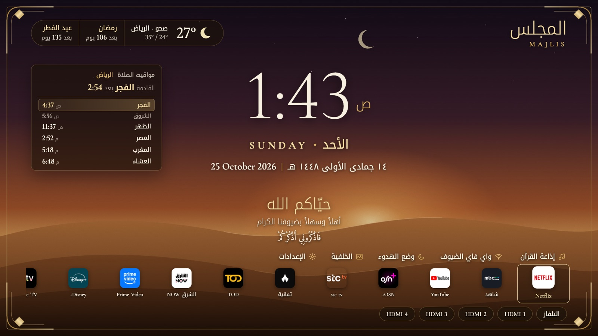
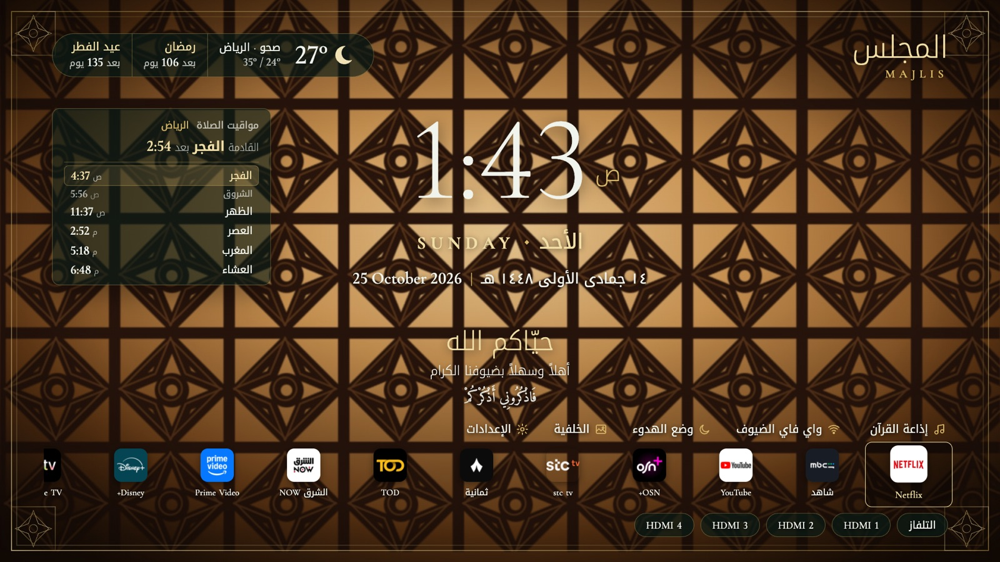
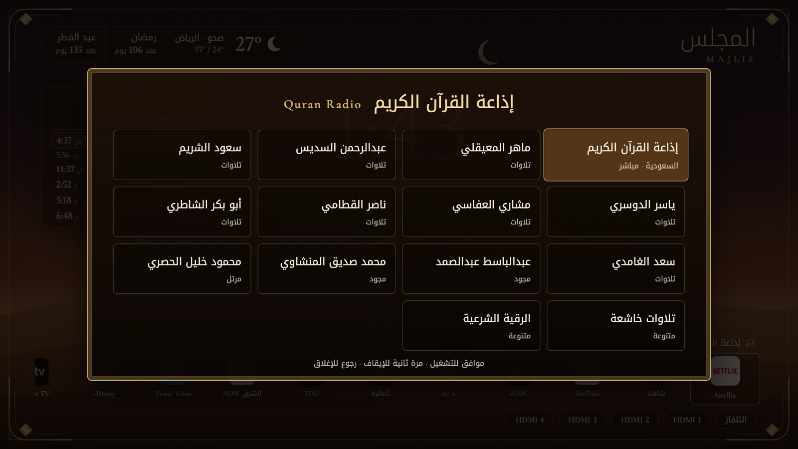
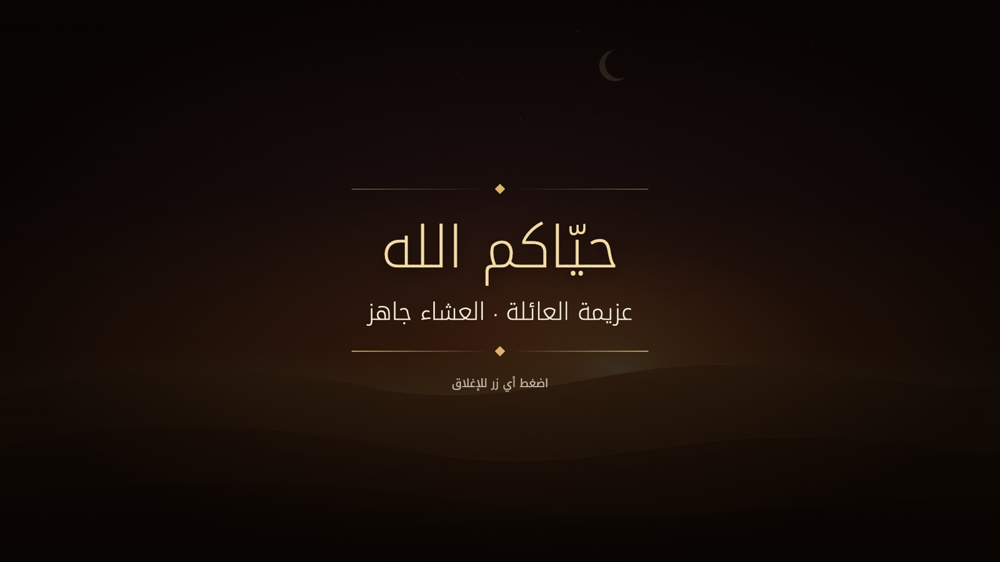
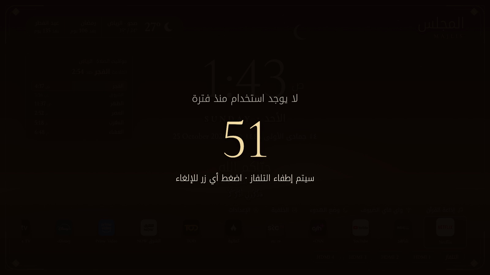
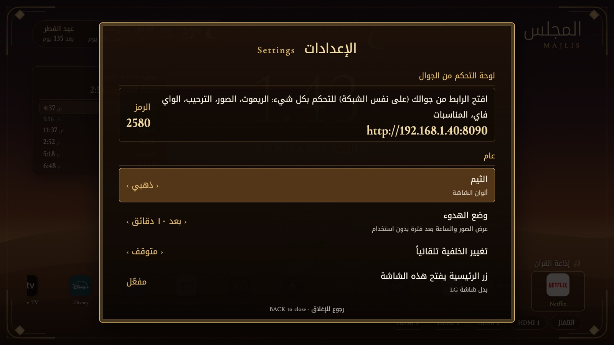

# المزايا

[English](../en/features.md) · [الرجوع للصفحة الرئيسية](../../README.ar.md)

كل اللي هنا تقدر تغيّره من تطبيق الجوال، وأغلبه من **الإعدادات** في التلفزيون.

## الشاشة الرئيسية

من فوق لتحت:
- **الاسم وشريط المعلومات**: اسم المجلس (تغيّره براحتك)، وطقس مدينتك، والمناسبات الجاية
- **مواقيت الصلاة**: الصلوات الخمس والشروق، والصلاة الجاية مميزة ومعها عدّاد
- **الساعة والتاريخ**: اليوم بالعربي والإنجليزي، والتاريخ الهجري (أم القرى) والميلادي
- **الترحيب**: سطر ترحيب، وسطر ثاني تكتبه أنت، وآية قصيرة تتغير كل ٢٠ دقيقة
- **الاختصارات**: إذاعة القرآن، واي فاي الضيوف، وضع الهدوء، الخلفية، الإعدادات
- **التطبيقات والمداخل**: تطبيقاتك (الجديدة تنضاف لحالها)، ثم التلفاز ومداخل HDMI

### أزرار الريموت

| الزر | وظيفته |
|---|---|
| الأحمر / الأخضر | الخلفية السابقة / التالية |
| الأصفر | تشغيل أو إيقاف إذاعة القرآن |
| الأزرق | بطاقة واي فاي الضيوف |
| الرئيسية | يفتح «مجلس» بدل شاشة LG |

## الشكل

| | |
|---|---|
|  |  |
| ثيم زمردي، إطار المشربية | ثيم السدو، الإطار النجدي |

- **الثيمات**: ذهبي، زمردي، سدو أحمر
- **ألوان الزخارف**: ذهبي، فضي، نحاسي، وردي ذهبي، فيروزي، لؤلؤي
- **الإطارات**: قصر، نجدي، مشربية، محراب، بسيط، بدون
- **الخلفيات**: كثبان الغروب، السدو، المشربية، أقواس القصر، الدمشقي الملكي، الخشب، الرخام البيج، وصورك الخاصة. تقدر تخفي أي وحدة، وتخليها تتغير تلقائياً.

## الصلاة

- المواقيت تنحسب على التلفزيون لمدينتك كل يوم. مدن السعودية على **تقويم أم القرى**، ومنها العشاء بعد المغرب بساعتين في رمضان. الكويت وقطر والإمارات على طرقها الرسمية.
- وقت الأذان تطلع بطاقة بملء الشاشة على شاشة المجلس. وإذا كنتم تشاهدون شي ثاني، يطلع إشعار فوقه.
- **وقت الأذان** (اختياري): إيقاف الفيديو مؤقتاً أو خفض الصوت، ويرجع بعد الأذان.
- **صوت الأذان** (اختياري): تختار من خمس تسجيلات تسمعها من الجوال قبل، أو تخليها نغمة هادئة.
- **تذكير** قبل الأذان: ٥ أو ١٠ أو ١٥ دقيقة.
- **وضع الجمعة**: الظهر يصير «الجمعة»، وتذكير بسورة الكهف الصبح، وإذاعة القرآن تقدر تشتغل لحالها.

## إذاعة القرآن

أربع عشرة محطة، منها إذاعة القرآن الكريم السعودية مباشر، وتلاوات المعيقلي والسديس والشريم والدوسري والعفاسي والقطامي والمنشاوي والحصري وغيرهم. البث من [mp3quran.net](https://mp3quran.net).

## الضيوف

### واي فاي الضيوف

تكتب الشبكة مرة وحدة من الجوال، والضيف يمسح الرمز بالكاميرا ويتصل.

### الرسائل والمناسبات

- **الرسائل**: ترسل «القهوة جاهزة» أو أي شي من الجوال، وتطلع بطاقة بملء الشاشة لين أحد يضغط زر. فيه رسائل جاهزة بضغطة.
- **المناسبات**: تضيف «عزيمة العائلة، الخميس ٩ مساءً». قبلها السطر اللي تحت الترحيب يعدّ («بعد ساعتين»)، ووقتها تطلع بطاقة ترحيب باسم المناسبة.
- **المناسبات الإسلامية**: رمضان وعيد الفطر ويوم عرفة وعيد الأضحى ورأس السنة الهجرية، عدّادها تلقائي.

## وضع الهدوء

بعد كم دقيقة بدون استخدام (من ٥ إلى ٣٠، أو متوقف)، الشاشة تصير عرض صور هادي لخلفياتك مع الساعة والتاريخ الهجري وآية وطقس الثلاث أيام الجاية والصلاة القادمة. أي زر يرجّع الشاشة الرئيسية. وشاشة التوقف حقت LG ما تطلع وهو مفتوح.

## حفظ الطاقة

إذا انترك التلفزيون على شاشة «مجلس» (أو قائمة LG) بدون ما أحد يستخدمه مدة تحددها (١٥ دقيقة، ٣٠ دقيقة، ساعة، ٤ ساعات)، يطلع عدّاد دقيقة. أي زر يلغيه، وإلا التلفزيون يطفي. مشاهدة أي تطبيق أو التلفاز أو مدخل HDMI ما تُحسب أبد، فما يطفي وأنتم في نص فيلم.

## الإعدادات في التلفزيون

فيها عنوان الجوال والرمز، وكل الخيارات اللي فوق. الأسهم للتنقل، وموافق أو ◀ ▶ لتغيير القيمة، ورجوع للإغلاق.

