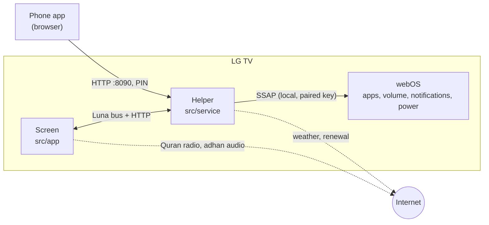

# كيف يعمل

[English](../en/how-it-works.md) · [الرجوع للصفحة الرئيسية](../../README.ar.md)

«مجلس» تطبيق مطوّر واحد من LG، فيه جزئين: **الشاشة** اللي تشوفها، و**مساعد** صغير يشتغل بالخلفية على التلفزيون.

## الشاشة (`src/app`)

HTML و CSS و JavaScript عادية بدون إطار عمل. تشتغل في محرك الويب حق التلفزيون، وهو قديم في بعض الموديلات (Chromium 79 في webOS 6)، فالكود يتجنب الأشياء الحديثة.

- مواقيت الصلاة تنحسب بمكتبة [adhan-js](https://github.com/batoulapps/adhan-js)، والتاريخ الهجري من تقويم أم القرى المدمج في المتصفح.
- الطقس من [Open-Meteo](https://open-meteo.com) (بدون مفتاح) كل ٣٠ دقيقة.
- فيه فيديو صغير صامت يشتغل بالخلفية عشان شاشة التوقف حقت LG ما تطلع فوق الشاشة الرئيسية.
- البيانات الثابتة (المدن، المحطات، الخلفيات، الأذان) في `src/app/data.js`، وترتيب التطبيقات الافتراضي في `src/app/apps-data.js`.

## المساعد (`src/service`)

خدمة JavaScript في webOS (Node 8 أو أحدث على التلفزيون). وظايفه:

- **يقدّم تطبيق الجوال** وواجهة JSON صغيرة على المنفذ 8090. أي شي يغيّر لازم الرمز، إلا إذا جا من التلفزيون نفسه.
- **يتكلم مع webOS عن طريق SSAP**، بروتوكول الريموت المحلي من LG على `wss://127.0.0.1:3001`. يستخدم المفتاح اللي من `npm run setup` عشان: يعرض التطبيقات، ويعرف وش المعروض، ويفتح التطبيقات، ويغيّر الصوت، ويرسل أزرار الريموت، ويعرض الإشعارات، ويطفي التلفزيون. LG ما تسمح لتطبيقات المطوّر تسوي هذا بالطريقة العادية، وعشان كذا يحتاج الربط.
- **يرجّع زر الرئيسية لـ«مجلس»**: لما تنفتح شاشة LG، يفتح «مجلس» مرة ثانية.
- **يجدول إشعارات الصلاة** فوق التطبيقات، والإيقاف أو خفض الصوت الاختياري وقت الأذان.
- **يشغّل مؤقت حفظ الطاقة** والمناسبات المجدولة.
- **يحافظ على نفسه شغّال**: نشاط يبقيه حي وهو شغّال، ونشاط دائم يعيد تشغيله خلال ٥ دقايق بعد إعادة تشغيل التلفزيون.
- **يجدد وضع المطوّر** كل ١٢ ساعة بالرمز اللي من التركيب.

الإعدادات والصور محفوظة في مجلد المساعد على التلفزيون (`data/`)، وتبقى بعد التحديث.

## التركيب والنشر (`scripts/`)

- `setup.mjs` يسجّل التلفزيون في [أداة webOS](https://github.com/webos-tools/cli)، وياخذ مفتاح المطوّر، ويربط SSAP، ويسوي الرمز. النتيجة تنحفظ في `.majlis/<name>.json`.
- `deploy.mjs` ينسخ `src/` إلى `build/<name>/`، ويضيف مفاتيح التلفزيون والرمز والبيانات والمكتبات، ويجهّز ملف `.ipk` ويركّبه.
- `preview.mjs` يعرض الشاشة على كمبيوترك للتصميم.
- `art/` فيه مصادر SVG للخلفيات والأيقونة.

## شاشة وحدة لثلاث أنظمة

الشاشة في `src/app` هي نفسها في كل مكان، والملف `src/app/platform.js` هو الوحيد اللي يعرف هو على أي نظام:

| | LG webOS | أندرويد تي في / جوجل تي في / فاير تي في | سامسونج Tizen |
|---|---|---|---|
| الشاشة | `src/app` في محرك الويب حق webOS | `src/app` داخل WebView بملء الشاشة (`android/` بلغة Kotlin) | `src/app` كتطبيق ويب Tizen (`samsung/config.xml`) |
| المساعد | `src/service` (Node على التلفزيون) | `HelperService.kt`: نفس واجهة HTTP على المنفذ 8090 | ما فيه: سامسونج ما تسمح بخدمات بالخلفية |
| فتح التطبيقات | Luna `applicationManager/launch` | Intents في أندرويد | `tizen.application.launch` |
| زر الرئيسية | المساعد يرجع من شاشة LG | «مجلس» تطبيق رئيسي فعلي (`CATEGORY_HOME`) | غير ممكن |
| فوق التطبيقات وقت الأذان | إشعار SSAP، وإيقاف الوسائط أو خفض الصوت | Toast، ونظام الصوت أو خفض الصوت | — |
| الإعدادات | المساعد وتطبيق الجوال | المساعد وتطبيق الجوال | من التلفزيون، ومن `majlis.config.json` وقت البناء |

تطبيق الجوال (`src/service/phone.html`) نفسه في LG وأندرويد، ويخفي اللي ما يقدر عليه النظام (مثل إطفاء التلفزيون في أندرويد).

## الخصوصية

- ما فيه حسابات ولا تتبّع ولا خوادم لـ«مجلس». ما يطلع شي من شبكة بيتك إلا:
  - طلبات الطقس لـ Open-Meteo بإحداثيات مدينتك
  - بث إذاعة القرآن من mp3quran.net وتسجيل الأذان، وقت تشغيلها بس
  - تجديد وضع المطوّر من LG (`developer.lge.com`)
- تطبيق الجوال يشتغل على شبكتك المحلية بس، ويحتاج الرمز لأي تغيير.
- المفاتيح اللي تتحكم بالتلفزيون تبقى في `.majlis/` على كمبيوترك وداخل التطبيق على التلفزيون، وما تنرفع على Git أبد.

## الحدود

- LG ما تسمح تبديل شاشتها الرئيسية بدون روت. «مجلس» يرجع لنفسه لما تنفتح شاشة LG، فممكن تشوفها لحظة.
- بعد انقطاع الكهرباء الكامل، المساعد يرجع خلال ٥ دقايق تقريباً، أو على طول لما تفتح «مجلس».
- أزرار الريموت من الجوال تمر عن طريق LG، فتشتغل في أغلب التطبيقات بس مو كلها.

