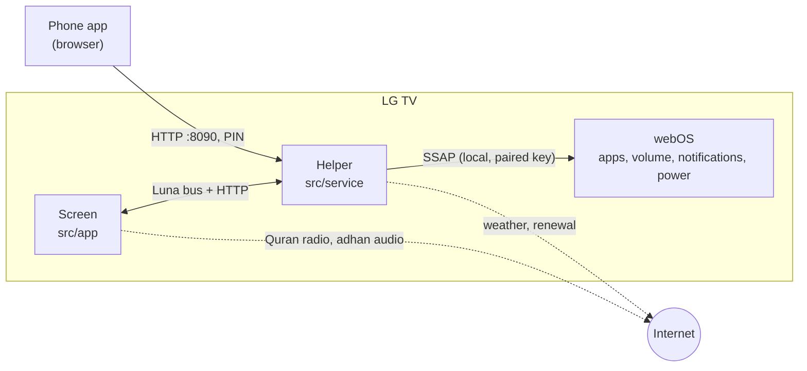

# How it works

[العربية](../ar/how-it-works.md) · [Back to README](../../README.md)

Majlis is one LG developer app made of two parts: the **screen** you see, and a small **helper** that keeps running in the background on the TV.

## The screen (`src/app`)

Plain HTML, CSS and JavaScript with no framework. It runs in the TV's web engine, which is old on some models (Chromium 79 on webOS 6), so the code avoids newer syntax and CSS (no optional chaining, no flex `gap`, no `inset`).

- Prayer times are calculated with [adhan-js](https://github.com/batoulapps/adhan-js). The Hijri date uses the browser's Umm al-Qura calendar.
- The weather comes from [Open-Meteo](https://open-meteo.com) (no key needed) every 30 minutes.
- A tiny silent video loops in the background, so LG's screensaver doesn't start over the home screen.
- Static data (cities, stations, backgrounds, adhans) lives in `src/app/data.js`. The default app order is in `src/app/apps-data.js`.

## The helper (`src/service`)

A webOS JavaScript service (Node 8 or newer on the TV). It:

- **Serves the phone app** and a small JSON API on port 8090. Anything that changes something needs the PIN, unless it comes from the TV itself.
- **Talks to webOS over SSAP**, LG's local remote-control protocol on `wss://127.0.0.1:3001`. It uses the key from `npm run setup` to list apps, see what's on screen, open apps, change volume, send remote buttons, show notifications and turn the TV off. LG doesn't let developer apps call these through the normal system bus, which is why the pairing is needed.
- **Sends the Home button back to Majlis**: when LG's launcher comes to the front, it opens Majlis again.
- **Schedules prayer notifications** over other apps, and the optional pause or lower-volume at adhan time.
- **Runs the energy-saving timer** and the scheduled occasions.
- **Keeps itself alive**: a keep-alive activity while it runs, and a persistent activity that restarts it within 5 minutes after a reboot.
- **Renews Developer Mode** every 12 hours, using the session token from setup.

Settings and photos are stored in the helper's folder on the TV (`data/`), so they survive updates.

## Setup and deploy (`scripts/`)

- `setup.mjs` registers the TV with LG's [webOS CLI](https://github.com/webos-tools/cli), fetches the developer key, pairs SSAP and creates the PIN. The result goes into `.majlis/<name>.json`.
- `deploy.mjs` copies `src/` into `build/<name>/`, adds that TV's keys and PIN, the shared data as JSON and the libraries, packages the `.ipk` and installs it.
- `preview.mjs` serves the screen on your computer for design work.
- `art/` has the SVG sources of the backgrounds and the icon.

## Privacy

- No accounts, analytics or Majlis servers. Nothing leaves your home network except:
  - weather requests to Open-Meteo, with your city's coordinates
  - Quran radio streams from mp3quran.net, and the adhan recording, only when they play
  - LG's Developer Mode renewal (`developer.lge.com`)
- The phone app works only on your local network and needs the PIN to change anything.
- The keys that control your TV stay in `.majlis/` on your computer and inside the app on the TV. They're never committed to Git.

## Limits

- LG doesn't allow replacing its launcher without rooting. Majlis switches back to itself when the launcher opens, so you may see LG's screen for a moment.
- After a full power cut, the helper starts again within about 5 minutes, or straight away when Majlis is opened.
- Remote buttons from the phone go through LG's pointer socket, so they work in most apps but not in every one.
