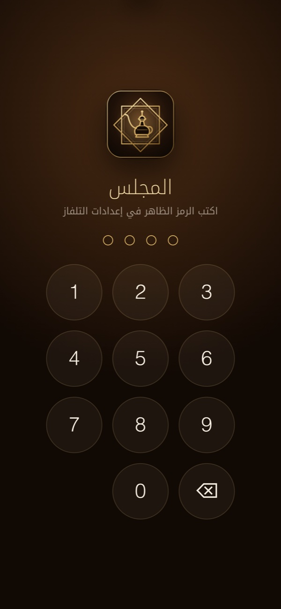
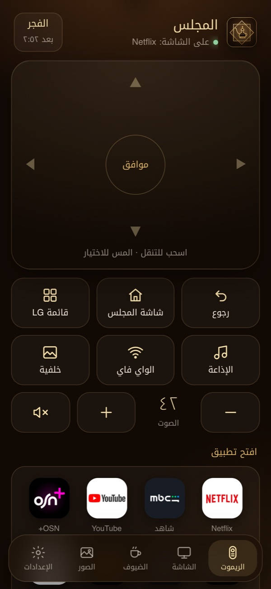
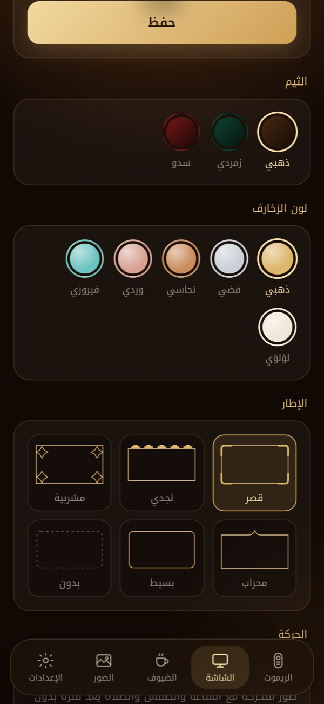
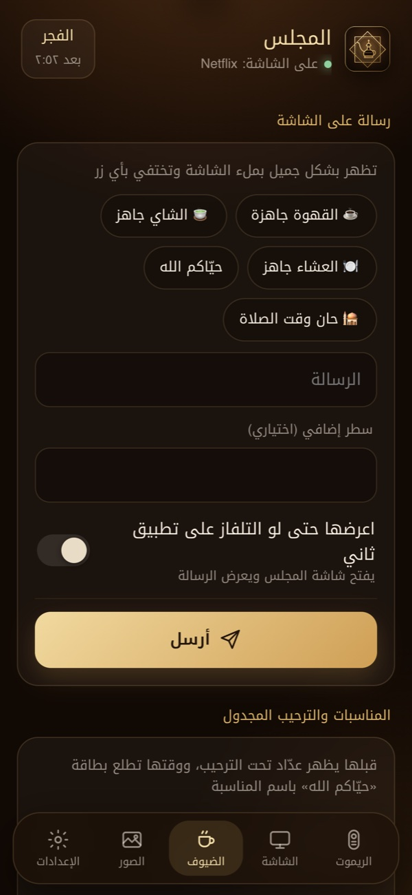
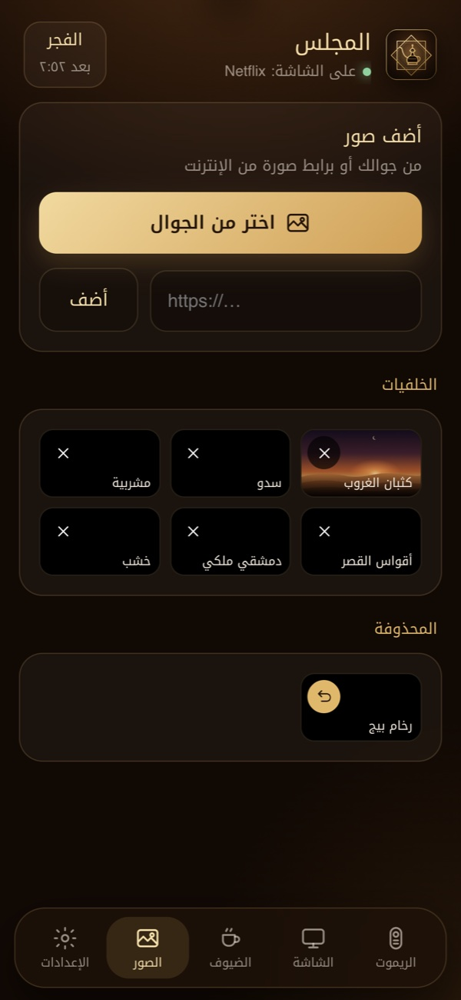
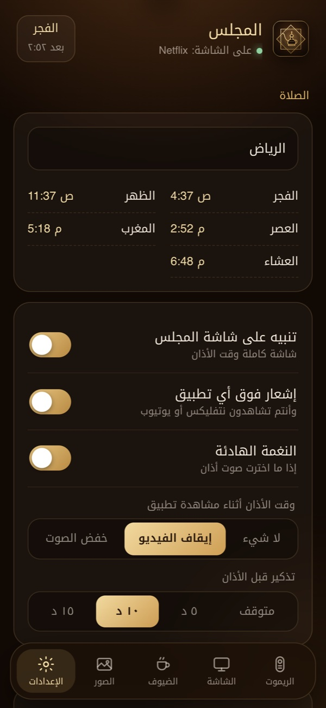
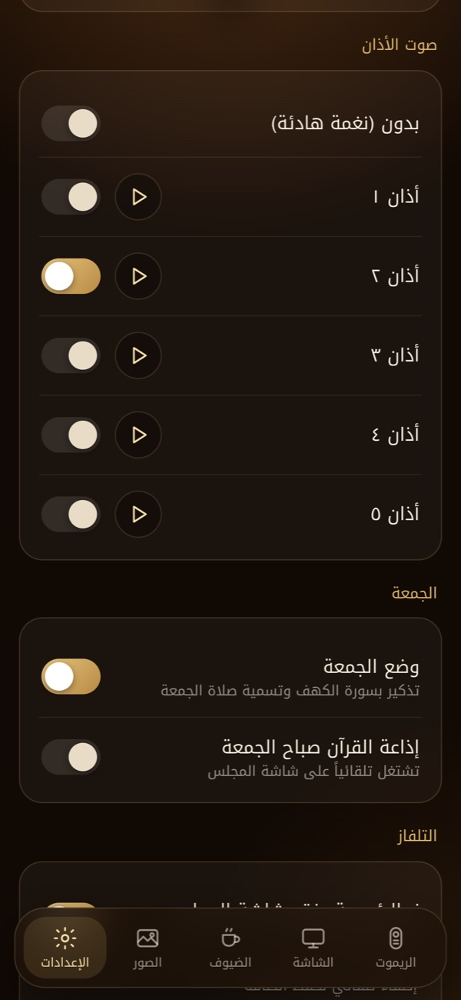

# The phone app

[العربية](../ar/phone.md) · [Back to README](../../README.md)

The TV serves its own control app on your home network. There's nothing to download from a store.

## Opening it

1. Connect the phone to the same Wi-Fi as the TV. (Guest networks often block devices from seeing each other; use the main network.)
2. Open `http://<tv-ip>:8090`. The address and the PIN are shown on the TV under **Majlis › Settings**.
3. Enter the 4-digit PIN.
4. Add it to your home screen so it opens full screen with its own icon:
   - **iPhone / iPad**: Safari → Share → **Add to Home Screen**
   - **Android**: Chrome → ⋮ → **Add to Home screen** (or **Install app**)

Anyone who should control the TV can do the same with the PIN.

  
  
  
  

The top of every screen shows what's on the TV right now and the next prayer.

## Remote

- **Touchpad**: swipe to move, tap to select. A long swipe moves several steps.
- **Buttons**: Back, Majlis home, LG menu, Quran radio, guest Wi-Fi, next background
- **Volume**: tap − or + for one step, hold to keep going. Mute is next to them.
- **Open an app**: your first twelve visible apps
- **Turn the TV off**

## Screen

- Majlis name (Arabic and English), the welcome line and the line under it
- Theme, accent colour and frame, with a preview of each
- Calm mode timing and automatic background changes

## Guests

- **Message on the screen**: ready-made messages or your own, with an optional second line. Turn on "show it even if the TV is on another app" to switch the TV to Majlis for it.
- **Occasions**: name, date and time. The countdown and the welcome card happen on the TV by themselves.
- **Guest Wi-Fi**: network name, password and security type. "Show now" puts the card on the TV.

## Photos

  
  
  

- Add photos from the phone (they're resized for the TV) or from a picture link on the web
- Remove any background with ✕; built-in ones go to "Removed" and come back with ↺

## Settings

- City, prayer alerts, what happens over other apps at adhan time, reminder before the adhan
- Adhan sound with ▶ preview
- Friday mode and Friday morning Quran radio
- Home button, energy-saving timer
- Apps: reorder with ▲ ▼, hide or show

Changes reach the TV straight away.
